# ♻️ Waste Detection with YOLOv8n

Real-time detection and classification of waste into **5 categories** (Contamination, Glass, Metal, Paper, Plastic), built by fine-tuning a pretrained **YOLOv8n** model. The model is small and fast enough for an embedded **waste-collection robot**, and it was used as the vision module for a campus robotics project (see [Real-World Application](#-real-world-application-waste-collection-robot)).


---

## 📌 Highlights

| | |
|---|---|
| **Model** | YOLOv8n (3,006,623 parameters, 8.1 GFLOPs, 6.2 MB weights) |
| **Task** | Object detection (bounding boxes + class + confidence) |
| **Classes** | Contamination, Glass, Metal, Paper, Plastic |
| **Test mAP@50** | **0.813** |
| **Test Precision / Recall** | **0.896 / 0.741** |
| **Test mAP@50-95** | **0.609** |
| **Inference speed** | ~2.0 ms/image (Tesla P100, 320×320) |
| **Training time** | ~17 minutes (50 epochs) |

---

## 📂 Repository Structure

```
.
├── waste-detection-using-yolov8n.ipynb   # Full training + evaluation + visualization notebook
├── README.md
└── images/
    ├── training_curves.png               # Loss and validation metrics per epoch
    ├── per_class_test_metrics.png        # Per-class precision / recall / mAP@50
    └── detection_*.png                   # Bounding box predictions on test images
```

---

## 🗂️ Dataset

- **Source:** Kaggle dataset `plasticwaste` (YOLO format, `data.yaml` with 5 classes)
- **Split:** 3,328 train / 998 validation / 633 test images
- **Data quality note:** Ultralytics automatically ignored images with out-of-bounds or non-normalized label coordinates: **48 train, 16 validation and 10 test** images. Effective sizes were therefore **3,280 / 982 / 623**.
- **Classes:** `Contamination`, `Glass`, `Metal`, `Paper`, `Plastic`

---

## ⚙️ Training Setup

| Parameter | Value |
|---|---|
| Base weights | `yolov8n.pt` (COCO pretrained, head re-initialised for `nc=5`) |
| Epochs | 50 |
| Image size | 320 × 320 |
| Batch size | 32 |
| Optimizer | AdamW (auto-selected, lr = 0.001111) |
| Augmentation | Ultralytics defaults (mosaic, HSV, flip, scale, translate, random erasing, Albumentations blur/CLAHE) |
| Mosaic | Turned off for the last 10 epochs (default `close_mosaic=10`) |
| Hardware | Kaggle Tesla P100 (16 GB) |
| Framework | Ultralytics 8.3.66, PyTorch 2.5.1 |

```python
from ultralytics import YOLO

model = YOLO('yolov8n.pt')
model.train(
    data='/kaggle/input/plasticwaste/data.yaml',
    epochs=50, batch=32, imgsz=320, workers=8,
    project='/kaggle/working/YOLOv8-Project',
    name='waste-detection', device=0, augment=True
)
metrics = model.val(data='/kaggle/input/plasticwaste/data.yaml', split='test')
```

---

## 📊 Results

### 1. Baseline vs. final model (test set)

I first ran a **1-epoch baseline** to check that the pipeline worked, then trained for **50 epochs**.

| Run | Precision | Recall | mAP@50 | mAP@50-95 |
|---|---|---|---|---|
| Baseline (1 epoch) | 0.353 | 0.454 | 0.370 | 0.228 |
| **Final (50 epochs)** | **0.896** | **0.741** | **0.813** | **0.609** |

Training for 50 epochs more than doubled mAP@50 (0.370 → 0.813) and raised precision by about 54 points.

### 2. Validation vs. test

| Split | Images | Instances | Precision | Recall | mAP@50 | mAP@50-95 |
|---|---|---|---|---|---|---|
| Validation | 982 | 1,756 | 0.870 | 0.713 | 0.801 | 0.595 |
| Test | 623 | 1,083 | 0.896 | 0.741 | 0.813 | 0.609 |

Test scores are slightly above validation, so there is no sign of overfitting to the validation set.

### 3. Per-class results (test set)

| Class | Images | Instances | Precision | Recall | mAP@50 | mAP@50-95 |
|---|---|---|---|---|---|---|
| **All** | 623 | 1,083 | 0.896 | 0.741 | 0.813 | 0.609 |
| Contamination | 76 | 235 | 0.791 | 0.438 | 0.531 | 0.355 |
| Glass | 146 | 194 | 0.959 | 0.943 | **0.972** | 0.797 |
| Metal | 150 | 166 | 0.927 | 0.920 | 0.935 | 0.719 |
| Paper | 58 | 87 | 0.958 | 0.621 | 0.786 | 0.589 |
| Plastic | 204 | 401 | 0.843 | 0.781 | 0.842 | 0.586 |

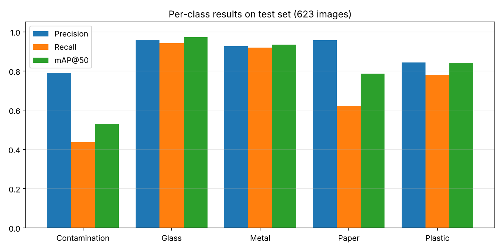

### 4. Training curves

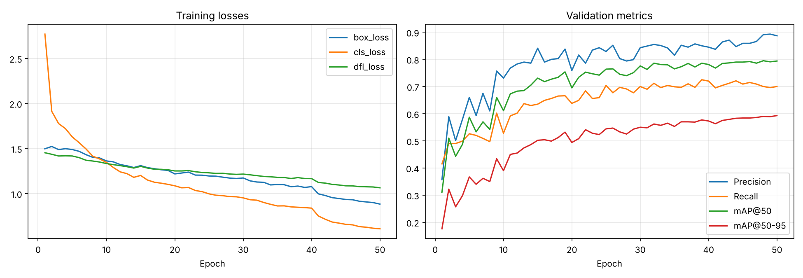

- Losses fall steadily over all 50 epochs (box loss 1.50 → 0.88, cls loss 2.77 → 0.61).
- Validation mAP@50 rises quickly during the first ~15 epochs and then plateaus near 0.79–0.80.
- Over the last 10 epochs (mosaic augmentation switched off) validation mAP@50 edges up slightly from ~0.78 to ~0.79–0.80.

### 5. Speed

| Stage | Time per image (test set) |
|---|---|
| Preprocess | 0.1 ms |
| Inference | 2.0 ms |
| Postprocess | 1.5 ms |

Measured on a Tesla P100 GPU at 320×320. Speed on a Raspberry Pi, Jetson or similar will be different and still needs to be measured.

---

## 🖼️ Sample Predictions (Bounding Boxes)

Detections from the final model on unseen test images (confidence in brackets).

### Metal
| | | |
|---|---|---|
| 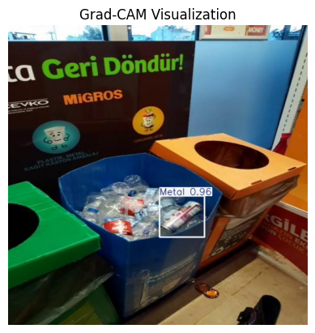 <br> Metal (0.96) | 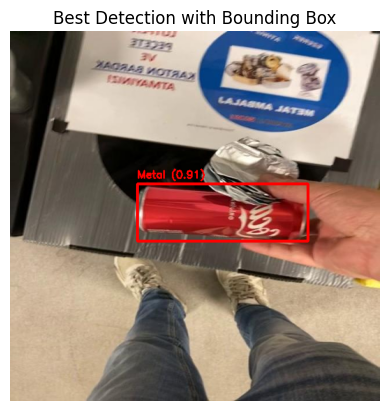 <br> Metal (0.91) | 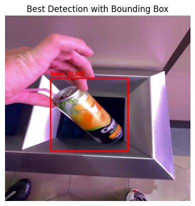 <br> Metal (0.89) |
|
### Plastic
| | | |
|---|---|---|
| 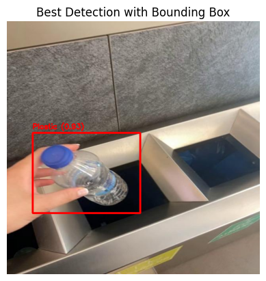 <br> Plastic (0.93) | 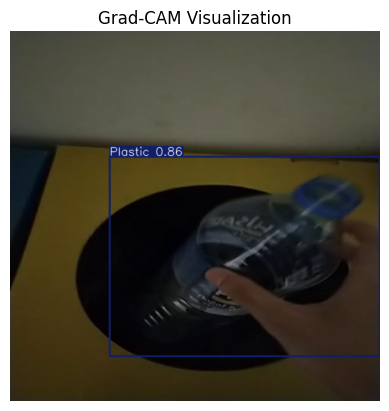 <br> Plastic (0.86) |
### Glass
| | |
|---|---|
| 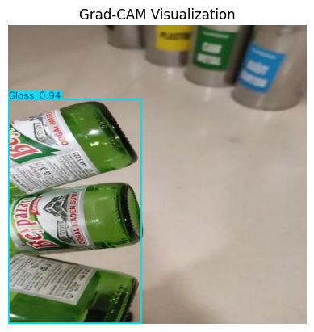 <br> Glass (0.94) | 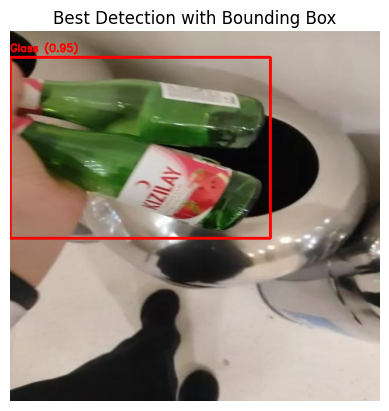 <br> Glass (0.95) |

### Paper
| | | |
|---|---|---|
| 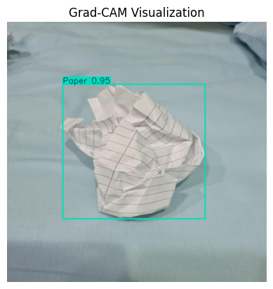 <br> Paper | 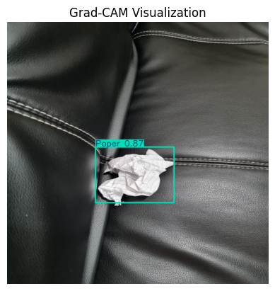 <br> Paper |

---

## 🔍 Findings & Analysis

1. **Glass and Metal are detected very reliably.** Both reach mAP@50 above 0.93 with precision and recall both around 0.92–0.96. Their distinct shape and reflective surfaces make them easy for a small model.
2. **Paper is precise but under-detected.** Precision is 0.958 but recall is 0.621, so when the model says "paper" it is usually right, but it misses many paper items. Paper has the fewest instances in the data (87 in the test set), which probably contributes.
3. **Contamination is the hardest class.** mAP@50 is 0.531 and recall is only 0.438. "Contamination" is a visually diverse catch-all category, which is hard for a 3M-parameter model to learn.
4. **Plastic is solid but not perfect.** It has the most samples (401 test instances) and mAP@50 of 0.842, but varied shapes, transparency and colours limit precision (0.843).
5. **Precision is higher than recall overall (0.896 vs 0.741).** The model is conservative: it makes few false alarms but misses some objects. For a collection robot this means few wrong pick-ups, but some waste may be skipped on the first pass.
6. **Strict-IoU performance is lower.** mAP@50-95 is 0.609 compared with 0.813 at mAP@50, so boxes are generally in the right place but not always tight. This matters if the robot arm needs accurate grasp points.
7. **Label quality matters.** Around 2% of images were dropped because of invalid bounding box coordinates. Cleaning those labels is an easy way to recover data.

---

## 🚧 Limitations

- Only 5 coarse classes. There is no fine-grained separation (e.g. PET vs. HDPE, organic waste).
- Images are resized to 320×320, which can hurt detection of small or distant objects.
- Low recall on Contamination and Paper.
- Evaluated only on the dataset's own test split. Performance in real outdoor conditions (lighting, motion blur, camera angle on the robot) has not yet been quantified.
- The reported speed is from a desktop-class GPU, not from the robot's hardware.

---

## 🚀 Future Improvements

- [ ] Fix or remove the out-of-bounds labels and retrain
- [ ] Add more Paper and Contamination samples and use class-balancing
- [ ] Train at 416 or 640 resolution and compare the accuracy/speed trade-off
- [ ] Try YOLOv8s/YOLO11n and compare with YOLOv8n
- [ ] Collect images from the robot's own camera and fine-tune on them (domain adaptation)
- [ ] Export to ONNX / TFLite / NCNN and benchmark on the robot's onboard computer
- [ ] Add a confusion matrix and PR curves to this repo

---

## ▶️ How to Run

```bash
pip install ultralytics
```

**Inference with the trained weights**
```python
from ultralytics import YOLO

model = YOLO('best_model.pt')            # weights saved by the notebook
results = model('your_image.jpg', conf=0.25)
results[0].show()                        # draws bounding boxes
```

**Retrain:** open `waste-detection-using-yolov8n.ipynb` on Kaggle, attach the `plasticwaste` dataset, and run all cells.

> Add `best_model.pt` (6.2 MB) to the repo, or to a GitHub Release, so others can run inference without retraining.

---

## 🤖 Real-World Application: Autonomous Plastic Bottle Collector

My YOLOv8n waste-detection model served as the core AI/ML perception component of a **Autonomous Plastic Bottle Collector** developed by my campus mate. As the AI/ML Engineer contributing to this project, I focused on developing and training the detection model, evaluating its performance, and providing technical consultation on its application to the robot.

### My AI/ML Contribution

- **Core Detection Solution:** Developed and fine-tuned the YOLOv8n model to detect and classify five waste categories, providing the essential visual recognition capability for the Autonomous Plastic Bottle Collector robot.
- **Model Training & Evaluation:** Trained the model and evaluated its performance using precision, recall, and mAP metrics to assess its waste-detection capabilities.
- **AI/ML Consultation:** Provided technical guidance on model selection, training, evaluation, and the potential integration of the trained model into the robot's detection pipeline.
- **Real-World Application:** Contributed the machine-learning component that supports the robot's ability to recognize waste from camera images and identify objects for collection.

### Autonomous Plastic Bottle Collector Robot Project Reference

- 🔗 **Autonomous Plastic Bottle Collector project:** [Niaz Morshed Razon's Portfolio](https://nm-razon-portfolio.vercel.app/)
- **Role of the model:** The trained detector identifies and classifies waste in camera images, providing detection outputs that can support the robot's collection decisions.
- **Next step:** Further integration and testing of the detector within the robot's pipeline (camera → YOLOv8n → control logic), followed by evaluation of its real-world performance.

<!-- TODO: Add robot photos/demo video, hardware details, and on-robot evaluation results once available. -->

### Autonomous Plastic Bottle Collector Images

<table>
  <tr>
    <td align="center">
      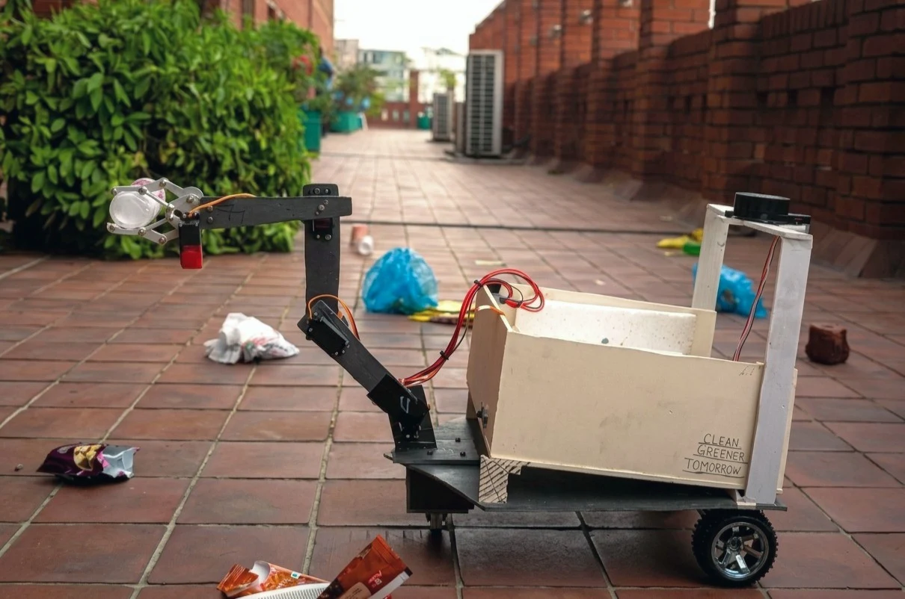<br>
      Robot
    </td>
    <td align="center">
      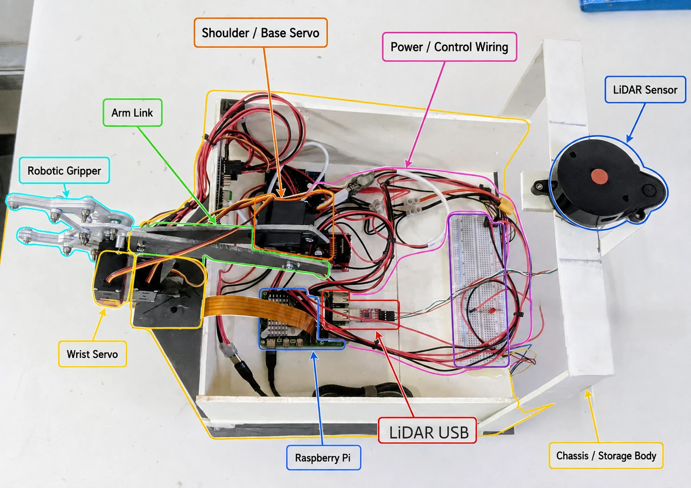<br>
      Robot Architecture
    </td>
    <td align="center">
      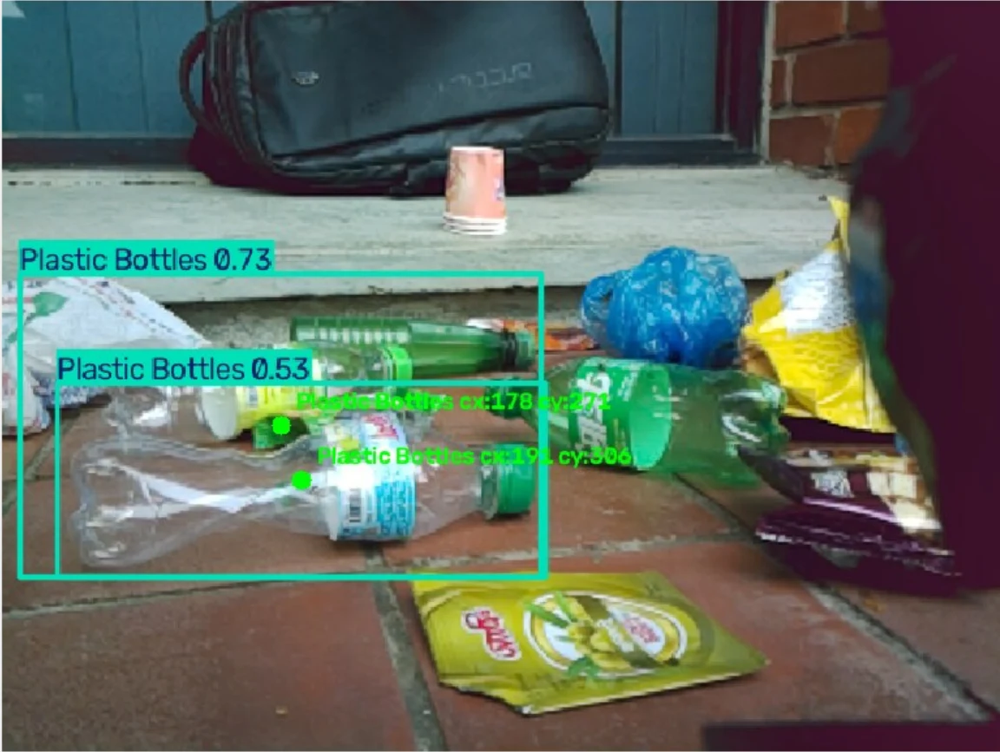<br>
      Plastic Detection
    </td>
  </tr>
  <tr>
    <td align="center">
      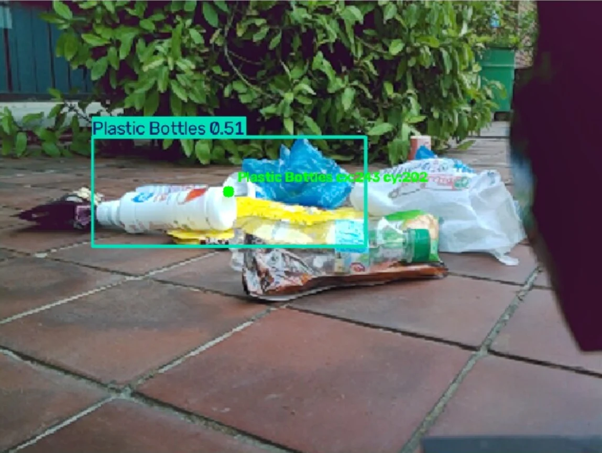<br>
      Plastic Detection
    </td>
    <td align="center">
      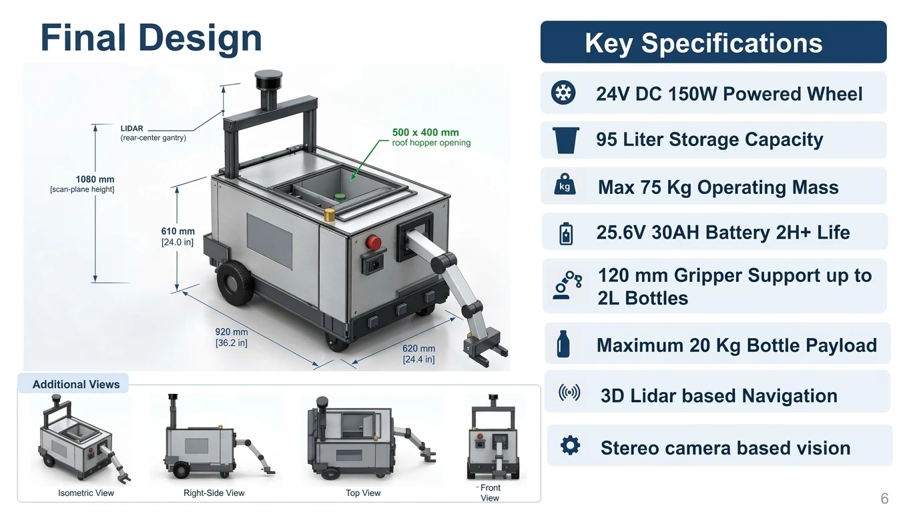<br>
      Robot
    </td>
    <td></td>
  </tr>
</table>
---

## 🛠️ Tech Stack

Python · Ultralytics YOLOv8 · PyTorch · OpenCV · Matplotlib · Kaggle (Tesla P100)

## 👤 Author

**Tridib Chakraborty** — AI/ML Engineer

- GitHub: [github.com/imtridib](https://github.com/imtridib)
- Kaggle: [kaggle.com/imtridib](https://www.kaggle.com/imtridib)
- LinkedIn: [linkedin.com/in/tridib-chakraborty-ewu-thk](https://www.linkedin.com/in/tridib-chakraborty-ewu-thk)
- Portfolio: [tridib-chakraborty.vercel.app/](https://tridib-chakraborty.vercel.app/)

**Robot Project Developer:** [Niaz Morshed Razon](https://nm-razon-portfolio.vercel.app/)

## 📜 License & Acknowledgements

- **Model:** [Ultralytics YOLOv8](https://github.com/ultralytics/ultralytics) (AGPL-3.0). Review the license terms before using or distributing the model, particularly for commercial applications.
- **Dataset:** Kaggle `plasticwaste` dataset. Please credit the original dataset authors and review the dataset license before redistribution or commercial use.
- **Robot Project:** Acknowledgements to Niaz Morshed Razon for developing the waste collection robot and applying the AI/ML detection model in the project.