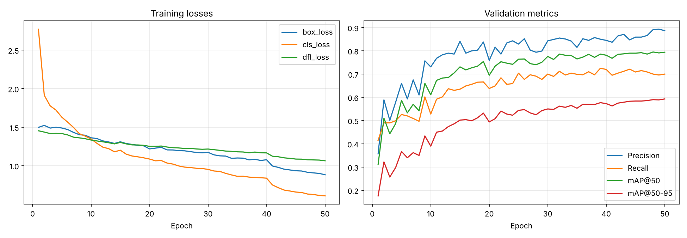
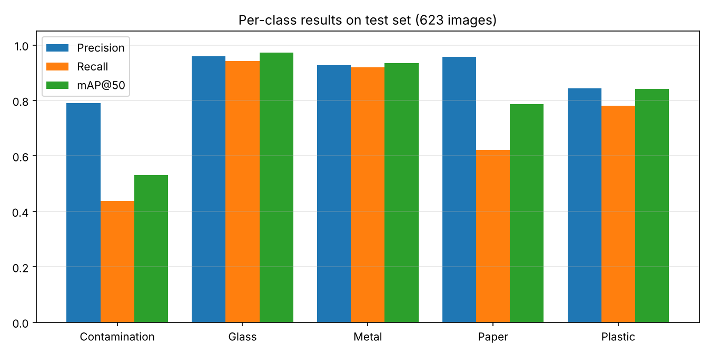

# ♻️ Waste Detection with YOLOv8n

A computer vision project focused on detecting and classifying waste into five categories using a fine-tuned YOLOv8n object detection model. The trained model was developed as the core AI/ML detection solution for a campus waste-collection robot project.

**My contribution:** AI/ML Engineer — model development, training, fine-tuning, evaluation, and AI/ML consultation for the robot implementation.


---

## Project Overview

The goal of this project was to develop a lightweight waste-detection model that can identify waste objects from images and provide bounding boxes, class labels, and confidence scores.

I fine-tuned a pretrained YOLOv8n model on a waste dataset containing five categories:

- Contamination
- Glass
- Metal
- Paper
- Plastic

The trained model was subsequently used as the vision component of a waste-collection robot developed by a campus mate. I contributed to the AI/ML side by developing and training the detection model and providing technical consultation on its use in the robot.

## My Role and Contribution

### AI/ML Engineer — Core Detection Solution

I was responsible for developing the machine-learning component that enables the robot to recognize waste.

- Selected and fine-tuned the pretrained YOLOv8n model for five waste categories.
- Prepared the training workflow and configured model training and evaluation.
- Evaluated model performance using precision, recall, mAP@50, and mAP@50–95.
- Analyzed class-wise performance and identified areas for improvement.
- Generated bounding-box predictions and visualized detection results.
- Consulted on the AI/ML aspects of the waste-collection robot, including the use of the trained model as its detection component.

The robot's physical design and collection mechanism were developed separately. My contribution focused on the core AI/ML detection solution and technical support for its application.

---

## Model Results

The final model was trained for 50 epochs and evaluated on the dataset's test split.

| Metric | Final test result |
|---|---:|
| Precision | **89.6%** |
| Recall | 74.1% |
| mAP@50 | **81.3%** |
| mAP@50–95 | 60.9% |
| Inference time | ~2.0 ms/image |

The reported inference time was measured on a Tesla P100 GPU at 320 × 320 resolution. This is not an on-robot performance measurement.

### Baseline vs. Final Model

| Run | Precision | Recall | mAP@50 | mAP@50–95 |
|---|---:|---:|---:|---:|
| Baseline — 1 epoch | 0.353 | 0.454 | 0.370 | 0.228 |
| Final — 50 epochs | **0.896** | 0.741 | **0.813** | **0.609** |

The 50-epoch model substantially improved detection performance compared with the initial baseline.

### Per-Class Test Results

| Class | Precision | Recall | mAP@50 | mAP@50–95 |
|---|---:|---:|---:|---:|
| Contamination | 0.791 | 0.438 | 0.531 | 0.355 |
| Glass | 0.959 | 0.943 | **0.972** | 0.797 |
| Metal | 0.927 | 0.920 | 0.935 | 0.719 |
| Paper | 0.958 | 0.621 | 0.786 | 0.589 |
| Plastic | 0.843 | 0.781 | 0.842 | 0.586 |

### Findings

- **Glass and Metal:** Strongest detection performance, with mAP@50 values of 0.972 and 0.935.
- **Paper:** High precision but lower recall, indicating that the model misses some paper objects.
- **Contamination:** The most challenging category, with a test recall of 0.438.
- **Overall:** Precision is higher than recall, so the model is more likely to miss some waste than to classify an incorrect object as waste.

These results were obtained on the dataset's test split. They do not establish the same performance under real-world robot operating conditions.

---

## Training Configuration

| Parameter | Value |
|---|---|
| Base model | YOLOv8n (`yolov8n.pt`) |
| Training epochs | 50 |
| Image size | 320 × 320 |
| Batch size | 32 |
| Optimizer | AdamW |
| Dataset | `plasticwaste` — Kaggle |
| Training environment | Kaggle Tesla P100 |
| Framework | Ultralytics YOLOv8, PyTorch |

The model was trained using the Ultralytics training pipeline with data augmentation enabled.

---

## Model Outputs and Visual Results

The repository includes training visualizations, class-wise performance charts, and sample predictions with bounding boxes.

### Training Curves



### Per-Class Test Metrics



### Sample Bounding-Box Predictions

The following images show predictions from the final model on test images.

#### Metal

| | | |
|---|---|---|
|  |  |  |
|  |  |  |

#### Plastic

| | | |
|---|---|---|
|  |  |  |
|  |  |  |

#### Glass

| | |
|---|---|
|  |  |

#### Paper

| | | |
|---|---|---|
|  |  |  |

---

## Real-World Application: Waste Collection Robot

The trained YOLOv8n model was used as the core waste-detection solution for a campus waste-collection robot developed by my campus mate.

My contribution was focused on the AI/ML system: developing and training the detection model, evaluating its performance, and consulting on the model's application to the robot.

### Robot Project Images and Demo

Add photos or demo images of the robot here to show the physical project and its implementation.

<!-- Replace these placeholders with actual repository image paths after uploading the robot photos. -->

<!--  -->

<!--  -->

### Project Reference

- **Robot project:** [Niaz Morshed Razon's Portfolio](https://nm-razon-portfolio.vercel.app/)
- **Application:** Waste detection and classification for a waste-collection robot.
- **Model role:** Provides object-detection outputs that can be used by the robot's control and collection pipeline.

The reported model metrics above are from the dataset test split. Robot-specific detection accuracy, processing speed, and collection success rate have not been reported here.

---

## Limitations and Future Improvements

- Improve recall for Contamination and Paper.
- Clean invalid bounding-box annotations and retrain.
- Compare higher input resolutions such as 416 and 640.
- Evaluate the model using images captured by the robot's own camera.
- Benchmark inference speed on the robot's actual onboard hardware.
- Measure real-world detection performance and collection success rate.
- Explore model export and optimization for embedded deployment.

---

## Repository Structure

```text
.
├── waste-detection-using-yolov8n.ipynb
├── README.md
└── images/
    ├── training_curves.png
    ├── per_class_test_metrics.png
    ├── detection_metal_01.png
    ├── detection_plastic_02.png
    └── ...
```

The `images/` directory should contain the visual output files referenced in this README. Add the robot images to `images/robot/` after uploading them.

---

## How to Run

Install the required package:

```bash
pip install ultralytics
```

Load the trained weights and run inference:

```python
from ultralytics import YOLO

model = YOLO("best_model.pt")
results = model("your_image.jpg", conf=0.25)

results[0].show()
```

To reproduce training, open the notebook in Kaggle, attach the dataset, and run the cells.

The trained weights are not included in this repository unless separately uploaded. Add `best_model.pt` or provide a GitHub Release if you want others to run inference without retraining.

---

## Tech Stack

Python · Ultralytics YOLOv8 · PyTorch · OpenCV · Matplotlib · Kaggle

## Author

**Tridib Chakraborty**  
AI/ML Engineer

- [GitHub](https://github.com/imtridib)
- [Kaggle](https://www.kaggle.com/imtridib)
- [LinkedIn](https://www.linkedin.com/in/tridib-chakraborty-ewu-thk)

## Acknowledgements

- [Ultralytics YOLOv8](https://github.com/ultralytics/ultralytics)
- Kaggle `plasticwaste` dataset — please credit the original dataset authors and review its license before redistribution or commercial use.

